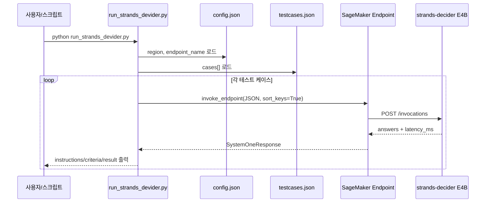

# Strands Decider

AWS SageMaker에 **Strands Decider E4B (Gemma 4)** 를 배포하고, 한국어 테스트 케이스로 호출하는 프로젝트입니다.

Upstream: [strands-labs/strands-decider](https://github.com/strands-labs/strands-decider) (Apache 2.0)  
배경 사례: [Amazon saves millions by replacing Sonnet with Strands Decider](https://strandsagents.com/blog/amazon-saves-millions-replacing-sonnet-with-strands-decider/)

## 목차

- [한 줄 요약](#한-줄-요약)
- [시스템 구성도](#시스템-구성도)
  - [전체 아키텍처](#전체-아키텍처)
  - [요청 흐름](#요청-흐름)
  - [설치 시 CDK가 만드는 것](#설치-시-cdk가-만드는-것)
- [디렉터리 구조](#디렉터리-구조)
- [사전 준비](#사전-준비)
- [설치 (installer.py)](#설치-installerpy)
  - [기본값](#기본값)
  - [실행](#실행)
  - [설치 단계](#설치-단계)
  - [설치 후 확인](#설치-후-확인)
- [실행 (run_strands_devider.py)](#실행-run_strands_deviderpy)
- [테스트 케이스 (testcases.json)](#테스트-케이스-testcasesjson)
- [실행 결과](#실행-결과)
  - [유형 설명](#유형-설명)
  - [케이스별 결과 요약](#케이스별-결과-요약)
  - [결과 분석](#결과-분석)
- [로컬 서버 테스트 (선택)](#로컬-서버-테스트-선택)
- [삭제 (uninstaller.py)](#삭제-uninstallerpy)
- [config.json](#configjson)
- [질문 유형 (API)](#질문-유형-api)
- [운영 팁](#운영-팁)
- [빠른 시작 체크리스트](#빠른-시작-체크리스트)
- [Reference](#reference)

## 한 줄 요약

| 항목 | 내용 |
| --- | --- |
| 모델 | `StrandsAgents/strands-decider-E4B-gemma4-v1-2610` |
| 배포 | SageMaker Real-time Endpoint (`deploy/sagemaker` CDK) |
| 기본 인스턴스 | `ml.g5.xlarge` (A10G 24GB, CUDA) |
| 리전 기본값 | `us-west-2` |
| 호출 | `boto3` `invoke_endpoint` ← `run_strands_devider.py` |
| 케이스 | `testcases.json` (한국어 noul / choice / score 10개) |

Strands Decider는 LLM처럼 텍스트를 생성하지 않고, **예/아니오·선택·점수**만 빠르게 판단하는 decision model(System One)입니다. 이 저장소는 그 모델을 AWS에 올리고 한국어 시나리오로 검증하는 운영 패키지입니다.

## 시스템 구성도

### 전체 아키텍처


### 요청 흐름



### 설치 시 CDK가 만드는 것

1. **S3 버킷** — Hugging Face에서 E4B 어댑터 + Gemma 4 base를 받아 저장 (CodeBuild)
2. **SageMaker Model** — DLC 이미지 + S3 `ModelDataSource` (`HF_HUB_OFFLINE=1`)
3. **EndpointConfig / Endpoint** — `ml.g5.xlarge` × 1, CUDA
4. **IAM Role** — 버킷 읽기, 이미지 pull, CloudWatch 로그
5. 배포 후 `installer.py`가 **endpoint ARN, Invoke URL, 스모크 결과**를 `config.json`에 기록

엔드포인트 API는 로컬 `POST /v1/systemone`과 동일한 본문이며, SageMaker 경로는 `POST /invocations` / `GET /ping`입니다.

## 디렉터리 구조

```text
strands-decider-kr/
├── README.md
├── installer.py              # SageMaker 배포 + config.json 생성/갱신
├── uninstaller.py            # CDK destroy + config 정리
├── run_strands_devider.py    # config + testcases → endpoint 호출 (단독 실행)
├── testcases.json            # 한국어 테스트 케이스 10개
├── test_systemone_examples.py# 로컬 serve URL용 러너 (testcases.json 사용)
├── config.json               # 배포 결과 (gitignore, installer가 생성)
└── deploy/sagemaker/         # 공식 strands-decider SageMaker CDK 앱
    ├── bin/
    ├── lib/
    ├── scripts/fetch-model.ts
    ├── cdk.json
    └── package.json
```

## 사전 준비

| 요구사항 | 설명 |
| --- | --- |
| AWS 자격 증명 | 계정에 SageMaker / CloudFormation / IAM / S3 / CodeBuild 권한 |
| Node.js 22+ | `npx cdk` 실행 (`deploy/sagemaker`) |
| Python 3.10+ | `boto3` 설치 |
| SageMaker 쿼터 | `ml.g5.xlarge for endpoint usage` ≥ 1 (Service Quotas) |

```bash
pip install boto3
# Node.js 22+ 필요
cd deploy/sagemaker && npm install && cd ../..
```

CDK bootstrap은 `installer.py`가 리전별로 없을 때 자동 실행합니다.

## 설치 (installer.py)

`deploy/sagemaker` CDK로 엔드포인트를 만들고, 결과를 `config.json`에 저장합니다.  
파일이 없어도 **기본값으로 새로 생성**합니다.

### 기본값

| 키 | 기본값 |
| --- | --- |
| `model.hub_id` | `StrandsAgents/strands-decider-E4B-gemma4-v1-2610` |
| `sagemaker.instance_type` | `ml.g5.xlarge` |
| `sagemaker.instance_count` | `1` |
| `region` | AWS 세션 리전, 없으면 `us-west-2` |

### 실행

```bash
python installer.py

# 옵션
python installer.py --region us-west-2
python installer.py --instance-type ml.g5.xlarge
python installer.py --model StrandsAgents/strands-decider-E4B-gemma4-v1-2610
python installer.py --skip-smoke
```

### 설치 단계

1. `config.json` 로드(없으면 생성) + CLI/기본값 반영 후 저장  
2. `deploy/sagemaker`에서 `npm install` (필요 시)  
3. `npx cdk bootstrap aws://<account>/<region>` (필요 시)  
4. `npx cdk deploy -c model=... -c instance_type=ml.g5.xlarge --require-approval never`  
5. CloudFormation Outputs / SageMaker Describe로 `config.json` 갱신  
6. 스모크 테스트 1건 (`noul` 긴급성) 후 `smoke_test` 필드 저장  

배포에는 모델 다운로드 + 엔드포인트 기동으로 **약 10~20분** 걸릴 수 있습니다.

### 설치 후 확인

```bash
aws sagemaker describe-endpoint \
  --endpoint-name strands-decider-e4b-gemma4-v1-2610 \
  --region us-west-2 \
  --query EndpointStatus
# InService
```

## 실행 (run_strands_devider.py)

`config.json` + `testcases.json`만으로 **단독 실행**합니다. (`test_systemone_examples.py` import 없음)

```bash
python run_strands_devider.py
python run_strands_devider.py --list
python run_strands_devider.py --only 1,4,8
python run_strands_devider.py --config ./config.json --cases ./testcases.json
```

동작 요약:

1. `config.json`에서 `region`, `sagemaker.endpoint_name`, `notes.sort_json_keys` 읽기  
2. `testcases.json`의 `cases[]` 로드  
3. 각 케이스의 `request`를 `sagemaker-runtime.invoke_endpoint`로 전송  
4. `instructions` / `criteria` / `result` / 클라이언트·서버 지연시간 출력  

JSON은 기본적으로 **`sort_keys=True`** 로 직렬화합니다. (키 순서만 달라도 확률이 흔들릴 수 있음 — Amazon 사례 블로그)

출력 예:

```text
endpoint=strands-decider-e4b-gemma4-v1-2610  region=us-west-2  instance=ml.g5.xlarge
---- is_urgent (noul) ----
instructions: 이 메시지에 긴급함이 느껴지나요?
result: noul=0.9560  → 예(true) 쪽
실행시간: 646.91 ms (클라이언트) / 105.84 ms (서버)
```

## 테스트 케이스 (testcases.json)

한국어 시나리오 **10개**. 형식:

```json
{
  "version": 1,
  "description": "...",
  "cases": [
    {
      "name": "01_noul_urgency",
      "description": "...",
      "request": {
        "state": "...",
        "questions": {
          "is_urgent": {
            "type": "noul",
            "instructions": "이 메시지에 긴급함이 느껴지나요?"
          }
        }
      }
    }
  ]
}
```

| # | 이름 | 유형 | 내용 |
| --- | --- | --- | --- |
| 01 | noul_urgency | noul | 정산 실패 메시지의 긴급성 |
| 02 | choice_team_routing | choice | 결제 / 영업 / 리테일 라우팅 |
| 03 | score_frustration | score | 좌절도 (차분함→절망적임) |
| 04 | multi_question | noul+choice+score | 한 state에 질문 3개 |
| 05 | language_detect | choice | 짧은 문구 언어 분류 |
| 06 | factual_check | noul | strawberry r 개수 |
| 07 | sentiment | score | 문서 긍정성 |
| 08 | tool_gate | choice | 에이전트 다음 도구 선택 |
| 09 | needs_human | noul | 사람 에스컬레이션 여부 |
| 10 | answer_quality | score+noul | 답변 품질·실행 가능성 |

## 실행 결과

아래는 SageMaker Endpoint (`strands-decider-E4B-gemma4-v1-2610`, `ml.g5.xlarge`)에 대해  
`python run_strands_devider.py` 로 10개 케이스를 돌린 결과입니다.

### 유형 설명

| 유형 | 의미 | 이 프로젝트에서의 역할 |
| --- | --- | --- |
| **noul** | 예/아니오 확률 `P(true)` (0~1) | 긴급성, 사실 확인, 사람 에스컬레이션, 실행 가능성 |
| **choice** | N개 옵션 중 1개 + 확률·confidence | 팀 라우팅, 언어 감지, 툴 게이트 |
| **score** | 순서 척도의 기대값(연속값) | 좌절도, 긍정성, 답변 품질 |
| **multi** | 한 `state`에 noul+choice+score를 묶음 | 티켓 한 건을 한 요청으로 triage |
| **score+noul** | 품질 점수와 yes/no를 함께 | 에이전트 답변 평가 |

### 케이스별 결과 요약

| # | 유형 | 시나리오 | 결과 | 서버 latency |
| --- | --- | --- | --- | --- |
| 01 | noul — 긴급성 (README) | 정산 3일 실패 | **noul=0.956** → 예 | 105.6 ms |
| 02 | choice — 팀 라우팅 (README) | 동일 티켓 | **결제** (0.996, conf 0.994) | 104.3 ms |
| 03 | score — 좌절도 (README) | 동일 티켓 | **score≈1.19 ≈ 좌절함** (calm/frustrated/depressed) | 104.9 ms |
| 04 | multi — noul+choice+score | 한 요청에 3질문 | 긴급 0.957 / **결제** / 좌절≈1.19 | 220.1 ms |
| 05 | choice — 언어 감지 | `sihamba ngokushesha` | **줄루어** (0.975, conf 0.963) | 102.7 ms |
| 06 | noul — strawberry r 개수 | `strawberry`에 r이 3개? | **noul=0.457** → 아니오 쪽 | 102.9 ms |
| 07 | score — 긍정성 | 극찬 리뷰 | **score≈3.61 ≈ 매우 긍정적** (0~4) | 103.3 ms |
| 08 | choice — 툴 게이트 | 구독 해지·환불 | **환불생성** (0.990, conf 0.986) | 104.0 ms |
| 09 | noul — 사람 에스컬레이션 | 해킹·법적 위협 | **noul=0.9997** → 예 | 103.5 ms |
| 10 | score+noul — 답변 품질 | 비밀번호 재설정 Q&A | score≈2.29 ≈ 수용 가능 / **actionable 0.966** | 221.7 ms |

### 결과 분석

**잘 맞는 케이스 (에이전트·티켓 워크플로에 바로 쓰기 좋음)**

- **01 긴급성 / 02 팀 라우팅 / 03 좌절도**: README와 같은 지원 티켓 시나리오에서 E4B가 기대대로 동작합니다. 긴급성·결제팀·좌절 쪽이 모두 선명합니다.
- **04 multi**: 질문 3개를 한 번에 보내도 개별 결과와 거의 같고, 서버 지연은 ~220 ms로 단일 질문(~105 ms)의 약 2배 수준입니다. state를 한 번만 읽는 이점이 보입니다.
- **05 언어 감지**: 줄루어를 confidence 0.96으로 고름 — 짧은 분류에 강합니다.
- **08 툴 게이트**: `환불생성` 0.99 — 에이전트 `before_tool_call` 게이트에 적합합니다.
- **09 에스컬레이션**: **0.9997** — 사기/법적 위협 기준이 criteria에 있을 때 매우 확신 있게 “사람 필요”로 갑니다.

**해석에 주의할 케이스**

- **06 strawberry r 개수**: 정답은 **예(r이 3개)** 인데 모델은 **0.457 → 아니오 쪽**입니다. 문자 단위 세기·철자 퍼즐은 decision model의 약한 영역으로, confidence 임계값이나 LLM/규칙 폴백이 필요합니다.
- **10 답변 품질**: `명확하고 완전함`(0.483)과 `수용 가능함`(0.359)에 질량이 갈라져 score≈2.29, confidence 0.57입니다. 반면 **is_actionable=0.97**은 단계가 있다는 점은 잘 잡습니다. 품질 score만으로 자동 승인하기보다 confidence·noul을 함께 보는 편이 안전합니다.
- **07 긍정성**: 매우 긍정적(0.762)으로 기대와 일치합니다.

**지연시간**

| 지표 | 값 |
| --- | --- |
| 총 (클라이언트) | 약 **3.1 s** / 10건 |
| 평균 (클라이언트) | **~309 ms** |
| 서버 단건 | 대개 **~103–106 ms** |
| 서버 multi(3질문) | **~220 ms** |
| 첫 요청 | 클라이언트 ~593 ms (웜업/연결 포함 가능) |

E4B on `ml.g5.xlarge`에서 한국어 케이스도 서버 단건 **약 100 ms대**로, Amazon 사례(~640 ms, 당시 측정 조건)보다 짧은 편입니다. 클라이언트 시간은 네트워크 RTT가 포함됩니다.

**실무 권장**

1. 라우팅·툴 게이트·에스컬레이션처럼 **닫힌 선택지**는 confidence ≥ 0.9일 때 자동 적용.  
2. 문자 세기·열린 추론은 Decider만으로  determin하지 말고 폴백.  
3. 티켓 triage는 **04 multi**처럼 한 요청에 묶어 RTT를 절약.  
4. JSON은 `sort_keys=True`로 보내 회귀 비교를 안정화.

## 로컬 서버 테스트 (선택)

로컬에 모델을 띄운 뒤 HTTP로 같은 `testcases.json`을 돌릴 때:

```bash
# 별도 터미널
strands-decider serve StrandsAgents/strands-decider-E4B-gemma4-v1-2610 --port 8000

python test_systemone_examples.py --base-url http://localhost:8000
python test_systemone_examples.py --cases ./testcases.json --only 1,2 --list
```

## 삭제 (uninstaller.py)

CDK 스택과 SageMaker 엔드포인트를 제거하고, `config.json`의 배포 결과 필드를 정리합니다.  
재설치에 필요한 `model` / `instance_type` / `cdk_context`는 남깁니다.

```bash
python uninstaller.py          # 확인 프롬프트
python uninstaller.py --yes    # 확인 없이 삭제

# 배포 때와 동일한 모델/인스턴스를 명시할 수도 있음
python uninstaller.py \
  --model StrandsAgents/strands-decider-E4B-gemma4-v1-2610 \
  --instance-type ml.g5.xlarge \
  --yes
```

삭제 후:

- CloudFormation 스택 `strands-decider-e4b-gemma4-v1-2610` 제거  
- Endpoint / EndpointConfig / Model / S3 모델 버킷 등 스택 리소스 삭제  
- `config.json`의 `endpoint_arn`, `invoke_url`, `smoke_test` 등 제거, `endpoint_status=Deleted`  

> 엔드포인트는 **요청이 없어도 인스턴스 시간당 과금**됩니다. 실험이 끝나면 `uninstaller.py`로 지우세요.

## config.json

`installer.py`가 생성·갱신합니다. **gitignore 대상**이라 커밋되지 않습니다.

주요 필드:

```json
{
  "project": "strands-decider-kr",
  "account_id": "262976740991",
  "region": "us-west-2",
  "model": {
    "hub_id": "StrandsAgents/strands-decider-E4B-gemma4-v1-2610",
    "revision": "main",
    "served_name": "strands-decider-E4B-gemma4-v1-2610"
  },
  "sagemaker": {
    "stack_name": "strands-decider-e4b-gemma4-v1-2610",
    "endpoint_name": "strands-decider-e4b-gemma4-v1-2610",
    "endpoint_arn": "arn:aws:sagemaker:us-west-2:...:endpoint/...",
    "instance_type": "ml.g5.xlarge",
    "instance_count": 1,
    "device": "cuda",
    "invoke_url": "https://runtime.sagemaker.us-west-2.amazonaws.com/endpoints/.../invocations",
    "image_uri": ".../strands-decider:serve-sagemaker-cuda-v1",
    "model_data_s3_uri": "s3://.../main/",
    "cdk_context": { "model": "...", "instance_type": "ml.g5.xlarge" }
  },
  "notes": {
    "invoke_permission": "sagemaker:InvokeEndpoint",
    "sort_json_keys": true
  }
}
```

호출 IAM: `sagemaker:InvokeEndpoint` on the endpoint ARN.

## 질문 유형 (API)

요청 본문 (`ContentType: application/json`):

| type | 의미 | 응답 |
| --- | --- | --- |
| `noul` | 예/아니오 확률 | `noul` = P(true) ∈ [0,1] |
| `choice` | N개 중 하나 | `choice`, `probabilities`, `confidence` |
| `score` | 순서 척도 기대값 | `score`, `legend`, `probabilities`, `confidence` |

```python
import json, boto3

runtime = boto3.client("sagemaker-runtime", region_name="us-west-2")
body = {
    "state": "도와주세요! 정산금 지급이 3일째 계속 실패하고 있어요!",
    "questions": {
        "is_urgent": {
            "type": "noul",
            "instructions": "이 메시지에 긴급함이 느껴지나요?",
        }
    },
}
resp = runtime.invoke_endpoint(
    EndpointName="strands-decider-e4b-gemma4-v1-2610",
    ContentType="application/json",
    Body=json.dumps(body, ensure_ascii=False, sort_keys=True).encode("utf-8"),
)
print(json.loads(resp["Body"].read()))
```

## 운영 팁

- **동시성**: DLC 기본 `DECIDER_MAX_CONCURRENCY=1` 유지 권장 (버스트 시 OOM 방지).  
- **JSON 키 순서**: 비교·회귀 테스트 시 `sort_keys=True`.  
- **용량 부족**: CDK context `fallback_instance_types` (예: `ml.g6e.xlarge,ml.g6.xlarge`) — 필요 시 `installer`/`cdk_context`에 추가.  
- **비용**: Amazon 사례 기준 E4B on `ml.g5.xlarge`는 티켓당 비용이 Sonnet 대비 약 **98% 절감** 수준으로 보고됨. 유휴 삭제가 중요.  
- **로그**:

```bash
aws logs tail /aws/sagemaker/Endpoints/strands-decider-e4b-gemma4-v1-2610 \
  --region us-west-2 --since 1h --follow
```


## 빠른 시작 체크리스트

```bash
# 1) 배포
python installer.py

# 2) 케이스 실행
python run_strands_devider.py --list
python run_strands_devider.py

# 3) 실험 종료 후 삭제 (과금 중단)
python uninstaller.py --yes
```

## Reference

- Upstream: https://github.com/strands-labs/strands-decider  
- SageMaker 배포 가이드: https://github.com/strands-labs/strands-decider/tree/main/deploy/sagemaker  
- DLC: https://aws.github.io/deep-learning-containers/strands-decider/  
- 모델 (E4B): https://huggingface.co/StrandsAgents/strands-decider-E4B-gemma4-v1-2610  
- Amazon 사례 블로그: https://strandsagents.com/blog/amazon-saves-millions-replacing-sonnet-with-strands-decider/  
